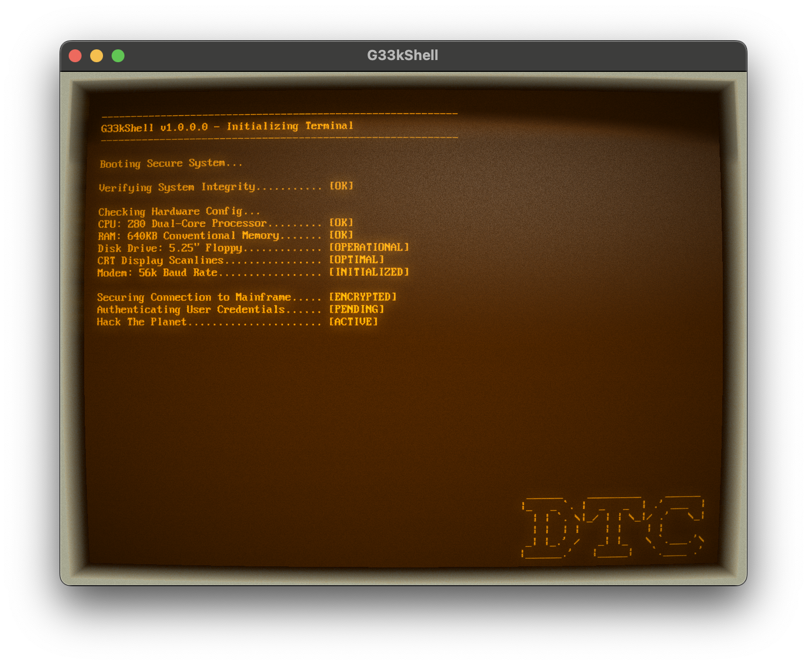
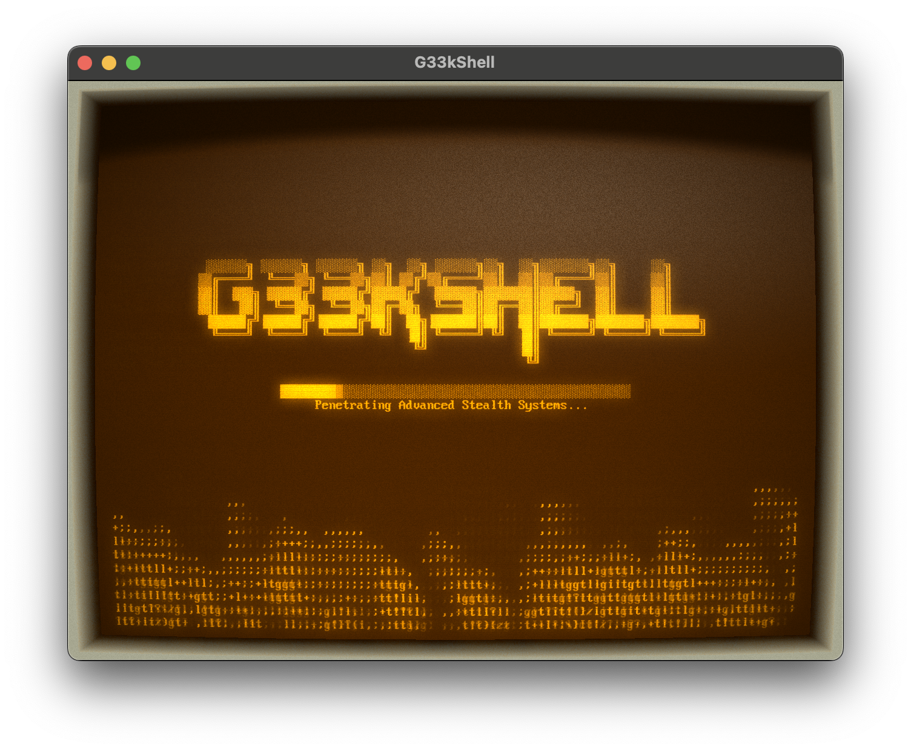
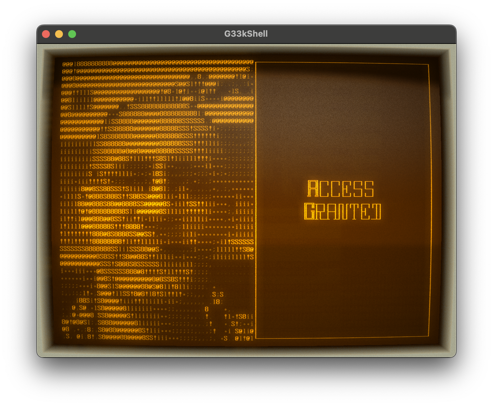

# G33kShell
**G33kShell** is a cross-platform retro-themed desktop shell that wraps a CRT aesthetic around a custom command experience.

## Highlights
- Boot-up BIOS prelude, login theatrics, and optional webcam face detection.
- Powered by Avalonia on .NET for cross-platform hardware-accelerated rendering with crisp pixel fonts and shader-based scanlines.
- Extensive built-in command set spanning navigation, search, system info, automation, and novelty utilities.
- Inline `man` pages, persistent history, and settings that remember your favorite skins, screensavers, and working directories.
- Skin system with `RetroPlasma`, `RetroGreenDos`, `RetroMonoDos`, and `SimpleSkin`.
- Idle timeout hands ownership to animated ASCII and pixel-art screensavers — many driven by AI brains you can train live.

## Built-in Commands
- Navigate your filesystem with `dir`, `tree`, `cd`, `pushd`, `popd`, `paths`, and `location`.
- Inspect and manipulate files via `cat`, `tail`, `copy`, `rm`, `mkdir`, `find`, `grep`, `whereis`, and `open`.
- Integrate with the OS using `reveal`, `space`, `clip`, `now`, `ver`, `worktime`, `shutdown`, and `max`.
- Customize the experience with `skin`, `screensaver`, `man`, `help`, `history`, and the CP437 `ASCII` table.

Tip: run `man <command>` for auto-generated manual pages, or `help` to see every command and alias.

## Useful Command Tips
- Scroll the terminal with the mouse wheel or Ctrl-Up/Down. Typing returns to the current view.
- Reuse lines from the previous command's output with `$<n>` (for example, `cat $4`).
- Manage environment variables with `set` (list all), `set path` (case-insensitive prefix), `set foo=bar` (set for this session), or `set foo=` (remove). Use `set -u foo=bar` to also save for your Windows user, or `set -u foo=` to remove from both scopes. `set -u` lists saved user variables. Quote values containing spaces, for example `set foo="hello world"`. Saved changes apply to future processes; existing applications keep their own environment.
- Copy the last command output to the clipboard with `clip` (use `clip -n` to show line numbers or `clip 4` for a single line).

## Screensavers
Cycle anything you like with `screensaver -l` and `screensaver <name>` - add `_train` to the AI-powered ones to watch them learn in real time.

| Screensaver | Description |
| --- | --- |
| `aquarium` | Amber pixel aquarium with schooling fish, swaying weed, feeding and fading habitat changes. |
| `asciiroids` | AI Asteroids in ASCII; add `_train` to teach it. |
| `badapple` | Mono pixel-art silhouette animation in the Bad Apple style. |
| `boids` | Flocking boids orbit a wandering sphere. |
| `bounce` | Breakout-style brick field with ricocheting faces. |
| `clock` | Big retro clock for the night shift. |
| `conway` | Conway's Game of Life, always plotting. |
| `crystal` | Growing crystal shard in chunky pixels. |
| `cube` | Spinning 3D wireframe cube. |
| `defrag` | Disk defrag blocks click into place. |
| `donut` | The classic spinning ASCII torus. |
| `earth` | Rotating ASCII Earth, tiny and proud. |
| `fire` | Flickering fire buffer, CRT cozy. |
| `fluid` | Low-res fluid sim, surprisingly hypnotic. |
| `heist` | Your last screen gets stolen, then returned. |
| `lemmings` | Tiny lemmings on an endless march. |
| `mandelbrot` | Mandelbrot zooms in chunky characters. |
| `matrix` | Matrix-style code rain. |
| `neo` | Matrix corridor with glowing trails. |
| `pipes` | Chunky monochrome 3D pipes grow through a shaded pixel grid. |
| `plasma` | Old-school plasma waves. |
| `pong` | AI pong duel; add `_train` to coach it. |
| `quiverbloom` | A luminous parametric creature blooms and quivers in monochrome. |
| `sand` | Sand pours over your last screen and settles. |
| `science` | A roaming glass lens refracts a snapshot of your terminal. |
| `scroller` | Retro text scroller for demo vibes. |
| `snake` | AI snake that learns; add `_train`. |
| `stars` | Warp-speed starfield. |
| `swirl` | Hypnotic swirl patterns. |
| `tbibm` | The British IBM tribute with Friday-night swagger. |
| `terminator` | Pixelated Terminator portrait. |
| `tiefighter` | 3D Tie Fighter flyby. |
| `tron` | Light-cycle trails with a tracking camera. |
| `tunnel` | Endless ASCII tunnel run. |
| `twister` | Column twist effect. |
| `willy` | Miner Willy marches across the screen. |
| `worms` | Glowing worms wriggle across the grid. |
| `xenon` | Xenon 2 shopkeeper cameo. |

The `aquarium` screensaver uses a full-buffer palette blended from the active background and foreground colours and an aspect-matched pixel surface (normally 384 pixels wide). Fish school, feed and move between layers of swaying plants. After about two minutes they swim offscreen; the habitat then fades out, regenerates, and fades in. Its fish, rock and weed sprites come from the [Kenney Fish Pack](https://kenney.nl/assets/fish-pack), licensed CC0; the license is included with the assets.

In `random` mode, screensavers switch at a natural cycle ending when available: the end of Bad Apple, a completed defrag (after its completion message), a reassembled heist, a full sand screen, or the end of an AI game. Other effects, and cycles that run longer, switch after five minutes. Selecting a screensaver directly keeps its normal looping behavior.

AI-enabled screensavers (`asciiroids`, `pong`, `snake`) store their trained neural weights between runs so you can pick up right where your last session left off.

The `quiverbloom` screensaver is inspired by [Vitaliy Kaurov's Wolfram Community visualization](https://community.wolfram.com/groups/-/m/t/3516580) and the equations shared there by Daniel Sanchez.

### Bad Apple compression notes

The `badapple` screensaver uses a tiny custom 1bpp movie format rather than shipping thousands of source frames. The source animation started as 6,572 480x360 JPEG frames at 30 fps. We reduce those to 128x120 mono frames, sample the movie down to 5,258 frames at 24 fps, then store the pixels rotated by 270 degrees because those scanlines produce far fewer RLE runs. Playback rotates the pixels back while decoding into the pixel screen.

The frame stream is encoded as one continuous alternating run-length stream across frame boundaries. A single initial colour is stored, then each run byte either draws that many pixels and toggles colour (`1..255`), or extends the current colour by 255 pixels without toggling (`0`). The resulting blob is wrapped with the existing `ByteExtensions.Compress()` LZ4 helper.

Final asset numbers:

| Stage | Size |
| --- | ---: |
| Raw 128x120 1bpp frames at 24 fps | ~9.6 MiB |
| Rotated continuous RLE stream | 1,358,933 bytes |
| LZ4-packed `.bar` asset | 987,617 bytes |

Several tempting alternatives were tested and lost to this simpler format: row dictionaries, duplicate-frame references, cropped frame bounds, XOR deltas, bit-packed run tokens, previous-row reuse, and 16-bit run lengths. Rotation and 24 fps sampling were the only tricks that delivered worthwhile savings without complicating playback.

## Quick Start
- Install the [.NET 8 SDK](https://dotnet.microsoft.com/download).
- Clone the repo and restore dependencies: `dotnet restore`.
- Launch the desktop shell: `dotnet run --project G33kShell.Desktop`.

The application persists settings (skin, screensaver, path history, trained brains) under your user profile. Delete the settings file if you ever want a clean slate.

G33kShell also monitors its own memory use. It writes a detailed process, managed-heap, garbage-collection, renderer, visual-tree, terminal-history, and screensaver summary to the app log at startup and whenever working-set or private memory crosses another 256 MB boundary. On Windows, the log is stored at `%APPDATA%\G33kShell\log.txt`.

## Development Notes
- Run the unit suite with `dotnet test` from the repo root.
- Avalonia assets live under `G33kShell.Desktop/Assets`; screensavers under `G33kShell.Desktop/Console/Screensavers`.
- To build your own screensaver, implement `IScreensaver`, expose a unique `Name`, and drop the class into the screensavers folder — `screensaver -l` will pick it up automatically. Derive from `ScreensaverBase` and call `OnCycleCompleted()` at natural stopping points to support cycle-aware random switching.

## License
MIT © Dean Edis. See `LICENSE` for details.

### Golden Axe (private exercise)

Special thanks to **[atomic14](https://github.com/atomic14)** for
**[golden-axe](https://github.com/atomic14/golden-axe)**. That project's arcade data
extraction, technical documentation and TypeScript implementation were substantial
references for this native C# recreation. We directly reuse its extracted sprites,
palettes, animation scripts, level layouts, height maps, enemy spawn data and magic
effects. G33kShell's simulation, renderer and coded player controller were written
in C#, informed by that work. Golden Axe and its original artwork and game data
belong to **Sega**. See the [asset provenance notice](G33kShell.Desktop/Assets/GoldenAxe/NOTICE.txt)
for the reference revision and file sources.

This version also corrects rider positioning on the Chicken Leg mount: rider
offsets include the mount's per-frame animation offsets, keeping characters seated
over its body instead of too far forward while standing, walking and attacking.

`screensaver goldenaxe` plays a native C# recreation of all five main arcade areas with
skin-tinted monochrome graphics. Use `screensaver goldenaxe_color` for color.
Add `_fx` for soft ground shadows, softened sprite outlines, campfire effects, drifting ground fog, glowing dragon breath and fireballs with heat haze.
Use `screensaver goldenaxe_color_fx` for autoplay or `screensaver goldenaxe_play_color_fx` to play.
The effects mode adds distance shading and soft ground shadows near ledges in the main areas.
Add `_ao` to inspect the terrain shading mask. White means no adjustment and darker tones show stronger shading.
An optional `GoldenAxe/title.png` in the application's user settings directory displays
for 2½ seconds before play starts automatically.
Optional `GoldenAxe/map1.gmap` through `map4.gmap` recordings play after the corresponding
camp. The encoder uses one optimized 256-color palette per recording, stores deltas only across
the changed scanlines, and retains the source timing.
To convert local MP4 recordings, install Python's `av`, `brotli`, and `numpy` packages and run
`python tools/encode-golden-axe-maps.py --output <settings-directory>/GoldenAxe <map-files>`.
Add `_play` to take control: `screensaver goldenaxe_play_color` (color) or
`screensaver goldenaxe_play` (mono). Use the arrow keys to move, hold **Ctrl** to
attack, press **Tab** for magic and **Space** to jump. Magic and jumping work on foot
and in the saddle. Press
**Shift+Space** to dismount. **Ctrl+Space** performs a
back attack; double-tap Left or Right to run, then attack for a shoulder charge.
**Escape** returns to the console. Held keys clear when the window loses focus.
Press **1** for Ax Battler, **2** for Tyris Flare, or **3** for Gilius Thunderhead
(the dwarf). Selection is saved across runs and app restarts. A switch preserves
health and position and waits for an active move or spell to finish. Each hero uses
their own attacks, magic, portrait and mounted animations.
Clearing each area continues through the campaign, preserving the selected hero,
health, remaining lives and potions. Fresh starts and respawns grant one magic potion.
Four playable camp bonus rounds separate the five main areas, so the arcade stage
counter advances through stages 1 to 9. To start directly
in Turtle Village, use `screensaver goldenaxe_area2_play_color` (omit `_play` for
the coded player, or `_color` for monochrome). Use `screensaver goldenaxe_area3_play_color`
for the third area, with its broken bridge, red dragon and armoured knight.
`screensaver goldenaxe_area4_play_color` and `screensaver goldenaxe_area5_play_color`
start the last two areas directly, including skeletons, stronger soldier variants,
additional knights and the final Death Adder fight with his skeleton guards.
On the eagle's back in the fourth area, original feather sprites tumble past behind
and in front of the fighters. The effect works in color and mono, stops during camp,
and uses approximate drift timing, placement and palette selection.
After recovering from a knockdown, Death Adder winds up a cast and sends a lightning
bolt along the floor. It uses the extracted casting frames and projectile damage
boxes, deals one health bar of damage, and can be jumped. The recovery trigger,
travel speed and gentle depth tracking are approximations. The coded player attempts
to jump incoming bolts.

At camp, carried potions are visible beside the sleeping hero from the start.
Blue thieves steal them before the hero wakes to give chase; hitting them drops
potions to recover. Green thieves drop food that restores one health bar, up to
full health. Thieves carry a finite supply and run off when empty or when time expires.
The night palettes and camp spawn lists come from the extracted data.
Camp placements are adjusted to keep the group above the HUD. The coded player
chases thieves, prioritises food when hurt, and carries the collected supplies into
the next area. The round ends once the thieves have left and remaining drops have
been collected or expired. Manual controls work as usual;
magic is disabled during camp.

Without `_play`, the coded player controls the selected hero, fights the enemy waves and Bad Brothers,
collects potions, casts magic and rides Chicken Leg, the fire-breathing blue dragon or
the red dragon, which shoots travelling fireballs. Riderless beasts sit in their extracted resting pose for
five seconds, then run off if nobody mounts them. The coded player waits at the
screen edge while scrolling is locked, then resumes when the GO prompt appears.
Turtle Village includes its scrolling camera path, Amazon enemies and original spawn waves. Close attacks on ordinary
soldiers become knee-and-throw combos, and the hero uses back attacks against enemies
behind them. Dropped potions arc onto the ground; spell damage follows the peak
of the recorded effect. Grounded enemies collapse when the spell ends, then recover
or die according to their remaining health. The hero mixes walking, running, running jumps and shoulder
charges. Running jumps cross the broken bridge; missing a jump costs a life and
respawns the hero on safe ground. The HUD includes the hero's portrait, three health
bars and potion icons aligned within their slots;
each area and camp fades in and fades out. Defeating Death Adder and clearing his
guards shows a victory message. Completing the campaign or losing all lives starts
another run after a short pause; random mode receives a cycle event then.
The coded player routes around holes and rocks. Potion thieves now check terrain,
jump onto low ledges and turn away from walls or holes instead of walking through rock.
Stepping off a ledge now falls under gravity, including while mounted; downward
movement keeps the hero's feet above the HUD. Ordinary enemies seek out unoccupied
Chicken Legs and dragons and can reclaim them after being knocked off. They
wait about one second within mounting range before climbing aboard; getting hit
interrupts the attempt.
Riderless Chicken Legs and dragons wait five seconds, then run towards the nearer
screen edge and leave. Remounting resets that wait; fleeing beasts cannot be mounted.
A flashing **GO ->** prompt appears while the route ahead is clear and scrolling is
available. Palette fades use a private display copy, so death/restart and area
transitions preserve the original artwork colors.

The set-6 assets are bundled in `G33kShell.Desktop/Assets/GoldenAxe` and included
in build and publish output. See `NOTICE.txt` there for their source and Sega attribution;
the game assets are not covered by the source-code license. Rendering uses extracted sprites, animation timing, tile layers,
height data and spawn positions with a stable 256-color palette. Simulation runs
at 60 Hz independently of rendering; the coded input policy is separate from it.
Enemy decisions and some behaviours remain approximations. The original map and
ending cinematics are not reproduced; sound, music and trained AI remain future work.
